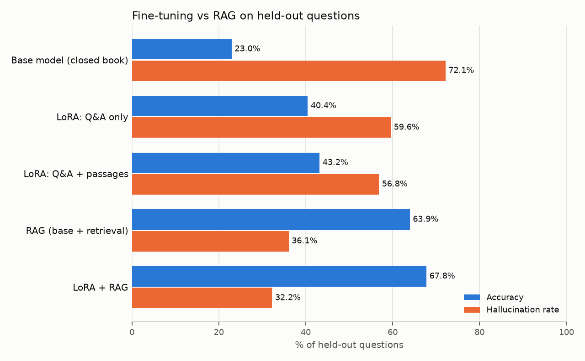

# LoRA-FineTuning

Fine-tune a small open model with **LoRA** (HuggingFace PEFT), then measure it
against a **RAG** pipeline on held-out questions, reporting **accuracy** and
**hallucination rate**.

The question this project answers: *if you want a model to answer questions
about a body of documents, should you bake the documents into the weights with
fine-tuning, or retrieve them at question time?*

## Setup at a glance

| Piece | Choice |
|---|---|
| Base model | [`Qwen/Qwen2.5-0.5B-Instruct`](https://huggingface.co/Qwen/Qwen2.5-0.5B-Instruct) |
| Fine-tuning | LoRA, rank 16, alpha 32, on all attention + MLP projections (~8.8M trainable params, 1.8% of the model) |
| Dataset | [`rag-datasets/rag-mini-wikipedia`](https://huggingface.co/datasets/rag-datasets/rag-mini-wikipedia): 918 human-written questions, ~3,000 Wikipedia passages |
| Split | 643 train / 92 val / 183 **held-out test**, stratified by yes/no vs factoid |
| Retriever | [`BAAI/bge-small-en-v1.5`](https://huggingface.co/BAAI/bge-small-en-v1.5) embeddings, cosine top-3 |
| Hardware | Apple M2 Pro (MPS), 16 GB |

## The five systems

| System | Knowledge comes from |
|---|---|
| **Base model** | whatever it learned in pre-training (closed book) |
| **LoRA: Q&A only** | training Q&A pairs. These teach answer *style*, but the facts behind the test questions are never shown |
| **LoRA: Q&A + passages** | training Q&A pairs **plus every corpus passage** as plain text, which puts the same knowledge RAG retrieves into the weights |
| **RAG** | base model + top-3 retrieved passages in the prompt |
| **LoRA + RAG** | the Q&A + passages adapter, also given retrieved passages |

Comparing the two LoRA systems separates *learning a format* from *learning facts*.

## Metrics

Each answer gets exactly one label (`lora_ft/metrics.py`):

- **correct**: yes/no questions must match on the first word; factoid answers
  must contain the gold answer (whole words, after normalization), be contained
  in it, or have token-F1 ≥ 0.5 with it.
- **abstained**: the model said it doesn't know. All systems are told to reply
  *"I don't know"* rather than guess.
- **hallucinated**: the model gave an answer and it was wrong.

**Accuracy** = correct / total. **Hallucination rate** = hallucinated / total.
They don't sum to 100%, because an honest "I don't know" is neither.

## Results

183 held-out questions (81 yes/no, 102 factoid), greedy decoding.



| System | Accuracy | Hallucination rate | Abstention rate | Yes/no acc. | Factoid acc. | Factoid halluc. |
|---|---:|---:|---:|---:|---:|---:|
| Base model (closed book) | 23.0% | 72.1% | 4.9% | 39.5% | 9.8% | 81.4% |
| LoRA: Q&A only | 40.4% | 59.6% | 0.0% | 76.5% | 11.8% | 88.2% |
| LoRA: Q&A + passages | 43.2% | 56.8% | 0.0% | 80.2% | 13.7% | 86.3% |
| RAG (base + retrieval) | 63.9% | 36.1% | 0.0% | 77.8% | 52.9% | 47.1% |
| **LoRA + RAG** | **67.8%** | **32.2%** | 0.0% | 84.0% | 54.9% | 45.1% |

Answering "Yes" to every yes/no question would score 80.2% on that subset.
With 183 questions, each number carries roughly ±7 points of sampling noise
(95% interval), so gaps under ~7 points (such as the two LoRA systems, or RAG vs
LoRA + RAG) are not reliable.

Training: Q&A only took 8 min (243 steps), Q&A + passages took 92 min (1,374 steps), 3 epochs each on an M2 Pro.

### What the numbers say

1. **RAG wins on facts by a wide margin.** On factoid questions RAG is right
   52.9% of the time, against 13.7% for the best closed-book LoRA. It also cuts
   the hallucination rate from 56.8% to 36.1%.
2. **Fine-tuning mostly learned the format, not the facts.** Most of the LoRA
   gain over the base model comes from yes/no questions. The base model answers
   "No" to 58% of them and is often wrong. The fine-tuned models learned the
   answer format and the label prior instead: 82% of training yes/no answers
   are "Yes", and the Q&A + passages adapter answered **"Yes" to all 81 test
   yes/no questions**. Its 80.2% yes/no accuracy is exactly the always-"Yes"
   baseline. On factoid questions, LoRA moved accuracy only from 9.8% to 13.7%.
3. **Training on the passages barely helped.** Three epochs of next-token
   training on the whole corpus added ~2–3 points over Q&A-only fine-tuning,
   which is within noise. Reliably injecting new facts into a 0.5B model with
   LoRA needs many more repetitions or paraphrased copies of each fact. RAG
   just puts the fact in the prompt.
4. **Fine-tuning made hallucination worse on factoid questions** (81.4% → 86–88%).
   The base model sometimes says "I don't know" (4.9%). The fine-tuned models
   never do, because none of their training answers were "I don't know". A model
   copies the confidence of its training data.
5. **The best system combines both.** The fine-tuned model reading retrieved
   passages scored the best accuracy (67.8%) and the lowest hallucination rate
   (32.2%). Fine-tuning supplies the answer format, and retrieval supplies the facts.
6. **Retrieval sets the ceiling for RAG.** The exact gold answer appears in the
   top-3 retrieved passages for 65% of factoid questions. RAG's 52.9% factoid
   accuracy is close to that, so a better retriever (more passages, reranking,
   hybrid BM25) would likely help more than a better generator.

### Ideas to push it further

- Add "I don't know" training examples (questions whose answers are not in
  the corpus) to teach the fine-tuned model to abstain.
- Rebalance yes/no training examples so the adapter can't win by always saying "Yes".
- Generate several paraphrased Q&A pairs per passage (synthetic data) for
  stronger knowledge injection, and try a 1.5B or 3B model on a machine with more memory.
- Replace lexical grading with an LLM judge for factoid answers.

## Run it yourself

```bash
python3.12 -m venv .venv && source .venv/bin/activate
pip install -r requirements.txt
PY=python ./run_all.sh
```

Or step by step:

```bash
python -m lora_ft.data                                # download, clean, split
python -m lora_ft.train_lora --recipe qa              # ~8 min on an M2 Pro
python -m lora_ft.train_lora --recipe qa_passages     # longer: 3,658 examples x 3 epochs
python -m lora_ft.evaluate --split test               # all five systems
python -m lora_ft.report --split test                 # table + chart in results/
pytest tests
```

Runs on CUDA, Apple Silicon (MPS) or CPU. To try a bigger model, change
`BASE_MODEL` in `lora_ft/config.py`.

## Project layout

```
lora_ft/
  config.py      model names, prompts, paths, device selection
  data.py        download, fix encoding, stratified split -> data/*.jsonl
  train_lora.py  LoRA fine-tuning with PEFT + HF Trainer (prompt tokens masked from loss)
  rag.py         dense retriever over the passage corpus
  evaluate.py    answer the held-out set with each system, grade, save predictions
  metrics.py     correct / abstained / hallucinated grading
  report.py      Markdown table + bar chart
data/            train / val / test questions and the passage corpus
results/         per-system predictions, metrics JSON, results table and chart
tests/           unit tests for the grader
```

## What LoRA is doing here

A full fine-tune updates all ~500M weights. LoRA freezes them and learns a
low-rank update for each targeted weight matrix: `W + (alpha/r) · B·A`, where
`A` is `r × d` and `B` is `d × r` with `r = 16`. Only `A` and `B` train, so the
adapter is a ~35 MB file that you can swap on and off the frozen base model.
`evaluate.py` does exactly that: it loads the base once and switches adapters with
`set_adapter` / `disable_adapter`.

Two details in `train_lora.py` matter:

- **Loss masking**: for Q&A examples the system prompt and question tokens get label
  `-100`, so the model is trained only to produce the answer, not to reproduce the prompt.
- **Passages as plain text**: passages are trained with ordinary next-token loss
  (continued pre-training), which is how new facts get into the weights.

## Notes and limitations

- **Lexical grading is approximate.** The grader can mark a correct paraphrase
  wrong, or a long answer that happens to contain the gold words right. Per-question
  predictions are saved in `results/predictions_*.jsonl` so you can audit them.
- **Yes/no questions are 44% of the set** and skew towards "Yes", so the report
  also shows an always-"Yes" baseline and splits accuracy by question type.
- Some questions only made sense next to their source article (e.g. *"What is
  the capital city?"*). Those are hard for every system.
- Validation loss (`results/training_log_*.json`) shows overfitting. The Q&A-only
  adapter is best after epoch 1 (1.89 → 2.24 by epoch 3), and Q&A + passages is
  flat from epoch 1 to 2 and then rises (1.74 → 1.74 → 1.80). Saving the best
  epoch, or training fewer epochs, would be the next tweak.
- Spot-checking 24 graded factoid answers found the labels mostly right. The
  misses are long, correct-in-spirit answers that fall under the F1 threshold.
- On a memory-constrained Mac, MPS memory fragments when every batch has a different
  shape. The trainer pads batches to multiples of 64 tokens and empties the MPS
  cache every 10 steps to stop the process from growing until the machine swaps.
